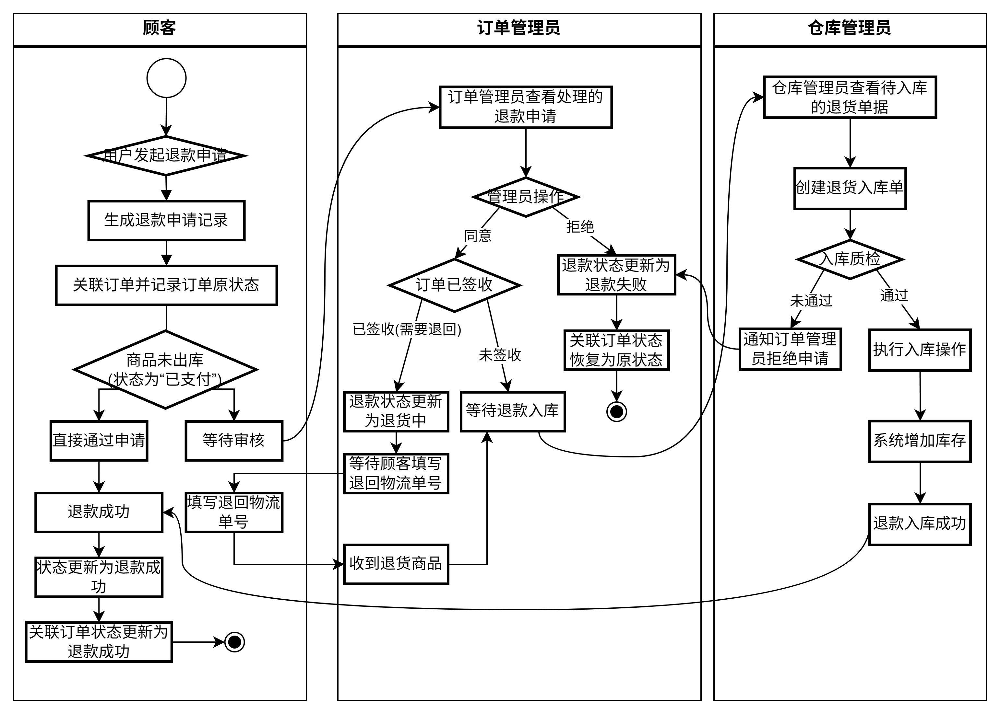

## 第一部分：用户视角

- [ ] **1. 开场及项目简介**
    - [x] 欢迎语，简要介绍项目定位：一个集成了前端用户商城、强大的后台管理系统、智能AI客服以及供应链管理功能的综合性电商平台。
    - [x] 说明采用的技术栈（Vue.js 前端, Django 后端）。
      - Vue的优点：
        - 组件化开发，易于维护和扩展。
        - 比较容易学习和上手。
      - django的优点：
        - 自带的后台管理系统，内置用户认证和权限管理。节省开发时间。
          - 但是自带的后台管理系统不够美观，不够灵活，不满足物流信息系统单据关联等的要求，因此，我通过js和css对其进行了二次开发。 
        - Django REST framework，方便构建API。
        - ORM框架，简化数据库操作。
    - [x] 明确本次演示目标：带大家完整体验用户购物、客服互动，并深入展示后台如何处理订单、管理库存，以及如何进行采购以支撑销售。

- [ ] **2. 用户账户与地址管理**
    - [ ] 登录用户账户。（使用提供的测试买家信息：账号 `evhiak0409@sandbox.com`，登录密码 `111111`）
    - [ ] 导航至“我的账户”或类似页面。
    - [ ] 进入“地址管理”模块。
    - [ ] **演示：** 展示如何查看、添加、编辑和删除收货地址。强调用户可以维护多个地址，并在结算时选择。

- [ ] **3. 用户购物流程演示**
    - [ ] **浏览与搜索商品:**
        - [ ] 返回商城首页，展示商品列表。
        - [ ] 演示分类筛选功能。
        - [ ] 演示搜索功能，搜索一个特定商品（例如，一个库存相对较低的商品，方便后续演示采购关联）。
    - [ ] **查看商品详情与加入购物车:**
        - [ ] 选择商品（例如，刚才搜索到的商品），进入详情页。
        - [ ] 突出显示：商品图片、详细描述、价格、规格、**当前库存量**（注意记录下库存）。
        - [ ] 操作：选择数量，点击“加入购物车”。
    - [ ] **购物车管理与结算:**
        - [ ] 进入购物车页面，确认商品。
        - [ ] 点击“去结算”。
        - [ ] 在结算页：确认商品清单、总金额。**选择或确认收货地址**（关联到刚才的地址管理）。
        - [ ] 点击“提交订单”。
    - [ ] **模拟支付与订单确认:**
        - [ ] 进入支付页面，说明支付是模拟的。
        - [ ] **使用支付密码：** `111111` 进行支付。
        - [ ] 显示支付成功提示。
        - [ ] 跳转至订单详情页或列表，显示刚刚支付成功的订单。
        - [ ] **重点：记下并强调新订单的订单号！** 这是连接前后端的关键。
        - [ ] 展示订单的当前状态（应为“待发货”或类似状态）。

- [ ] **4. AI智能客服互动**
    - [ ] 进入AI客服界面。
    - [ ] **演示提问：**
        - [ ] 清除聊天记录，开始新的对话。
        - [ ] 你好（展示AI问候用户）。
        - [ ] “我有几个订单？”（展示AI查询用户订单数量）。
        - [ ] “我的订单 `[刚才记下的订单号]` 买了什么我忘了，能帮我查一下吗？”（展示AI查询订单详情）。
        - [ ] “我的订单 `[刚才记下的订单号]` 什么时候发货？”（展示AI基于订单状态或预设回复）。
        - [ ] “能给我介绍一下你们平台的RedmiBook Pro 14吗？”（展示AI基于商品信息进行介绍）。
        - [ ] 这个我平时工作，性能够用吗？（展示AI基于商品信息进行介绍）。
    - [ ] 简要说明AI客服的价值。

---

## 第二部分：后台管理视角

- [ ] **1. 过渡语**
    - [ ] 引导观众视角切换至后台管理系统，强调后台是支撑前端运营的核心。

- [ ] **2. 登录Django Admin后台**
    - [ ] 打开后台登录页面。
    - [ ] 输入管理员用户名和密码，登录系统。

- [ ] **3. 用户和组权限管理 (Shopper -> User Management)**
    - [ ] 导航至“用户管理”模块。
    - [ ] **讲解：** 强调系统具备完善的权限控制机制，确保不同角色的管理员只能访问和操作其职责范围内的功能和数据。
    - [ ] **演示：**
        - [ ] 快速浏览用户列表，展示不同用户账号。
        - [ ] （可选）点开一个用户详情，展示其所属的用户组。
        - [ ] 导航至“组”管理模块。
        - [ ] 快速浏览不同的用户组（如：订单管理员、仓库管理员、采购员等），并简要说明每个组被赋予的权限范围。
        - [ ] **强调：** 用户密码是经过加密存储的，即使是数据库管理员也无法直接看到明文密码，保障用户数据安全。

- [ ] **4. 订单管理 (Shopper -> Order Infos)**
    - [ ] 导航至后台订单管理模块。
    - [ ] 使用刚才记录的订单号，搜索并找到该笔订单。
    - [ ] 点击进入订单详情页。
    - [ ] **详细展示：** 订单的所有信息，包括用户信息、收货地址（关联到用户端地址管理）、购买的商品列表、数量、金额、支付方式、支付状态、以及当前的订单状态（应为“待发货”）。
    - [ ] **讲解/演示：** 说明管理员可以在这里进行订单审核、修改状态（例如，如果用户未支付，管理员可以关闭订单；如果需要人工确认，可以标记为待处理）。

- [ ] **5. 库存与采购流程深度展示 (Commodity -> Commodity Infos & Logistics -> Purchase Stock In Orders)**
    - [ ] **查看库存变化：**
        - [ ] 导航至“商品信息”模块。
        - [ ] 找到刚才用户购买的商品。
        - [ ] **强调：** 展示该商品的当前库存量，对比用户下单前的库存（可以口述或提前截图），说明用户下单并支付成功后，库存已经被系统自动扣减。
    - [ ] **讲解采购触发：**
        - [ ] 说明当商品库存低于设定的安全库存或根据销售预测/订单需求判断需要补货时，系统会（或应该）触发采购流程。
        - [ ] **关联订单与采购：** 强调采购的根本目的是为了满足客户订单需求和维持合理的库存水平。用户的销售订单是驱动后续出库和潜在采购的源头。
    - [ ] **采购入库流程演示：**
        - [ ] 导航至“采购入库单”模块。
        - [ ] **讲解：** 采购流程通常涉及创建采购订单（向供应商下单），然后是供应商发货，最后是仓库收到货物并进行入库。这里我们重点演示“采购入库”这一环节。
        - [ ] **演示创建采购入库单：**
            - [ ] 点击“添加采购入库单”。
            - [ ] 选择供应商（如果模块支持）。
            - [ ] 添加采购的商品项目。**选择刚才库存减少的那个商品**，输入采购数量（例如，采购一批以补充库存）。
            - [ ] （可选）关联到采购订单号或其他内部单据。
            - [ ] 保存并提交采购入库单。
        - [ ] **验证库存更新：**
            - [ ] 返回“商品信息”模块，再次找到那个商品。
            - [ ] **强调：** 展示该商品的库存量已经因为采购入库而增加了。这完成了从销售引起库存下降，到通过采购补充库存的闭环。

- [ ] **6. 物流处理流程 (Logistics -> Outbound Orders & Logistics -> Logistics Orders)**
    - [ ] **出库管理：**
        - [ ] 导航至“出库单”模块。
        - [ ] **讲解：** 订单支付成功后，仓库管理员根据客户订单创建出库单，准备拣货和打包。
        - [ ] **演示：** 查找或创建与刚才客户订单关联的出库单。展示出库单中包含的商品信息与客户订单一致。说明出库单确认后，是实际的库存扣减操作（尽管在下单时已预扣或逻辑扣减，这里是物理出库确认）。
    - [ ] **物流单管理：**
        - [ ] 导航至“物流单”模块。
        - [ ] **讲解：** 商品打包并交给物流公司后，会生成物流单，记录运单号和承运商。
        - [ ] **演示：** 查找或创建一个与该出库单关联的物流单。展示运单号等信息。
        - [ ] **关联前端：** 再次强调，这里的物流信息会同步到前端，用户可以在订单详情页追踪物流状态。
        - [ ] **更新订单状态：** 讲解创建物流单并标记发货后，客户订单状态会更新为“已发货”。

- [ ] **7. (可选) 退货入库流程 (Shopper -> Refund Stock In Orders)**
    - [ ] 导航至“退货入库单”模块。
    - [ ] **简要说明：** 如果用户发起退货，商品退回仓库后，会通过退货入库流程将商品重新入库，更新库存。这是逆向供应链的管理。
- 

---

## 第三部分：总结

- [ ] **1. 回顾与总结**
    - [ ] 简要回顾演示的完整闭环：用户下单 -> 地址管理 -> 支付 -> AI客服 -> 后台订单接收 -> 库存扣减 -> 采购触发（因库存下降） -> 采购入库（补充库存） -> 出库处理 -> 物流发货 -> 用户端查看物流 -> （可选）退货处理。
    - [ ] 强调项目的完整性、前后端协同、以及对核心业务流程（销售、库存、采购、物流）的支持。
    - [ ] 突出项目亮点：流畅的用户体验、智能客服、精细化的后台运营管理、完整的供应链（采购、库存、物流）关联与追溯能力、以及安全的权限控制。

- [ ] **2. 结束语与提问环节**
    - [ ] 感谢大家的观看！
    - [ ] 现在是提问环节，欢迎大家提出宝贵的问题和建议。

---

## 演示准备检查清单：

- [ ] 确保演示环境稳定，前后端和数据库均正常运行。
- [ ] 准备好演示用的用户账号 (`evhiak0409@sandbox.com`) 及其登录密码 (`111111`) 和支付密码 (`111111`)。
- [ ] 准备好管理员账号和密码。
- [ ] 准备好可供演示的商品：至少包含一个库存相对较低的商品，方便演示库存扣减和采购触发。
- [ ] 提前在用户账号下设置好至少一个收货地址，并准备演示添加新地址。
- [ ] 提前演练整个流程，确保每个页面、每个操作、每句讲解都流畅自然。
- [ ] 准备好要演示的订单号（下单后快速记录）。
- [ ] （如果AI客服是重点）确保AI服务正常运行，并能对预设问题给出合理响应。
- [ ] 确保后台有不同的用户组和权限设置，方便演示用户权限管理。
- [ ] 确保后台有供应商信息（如果采购模块需要选择供应商）。
- [ ] 确保后台的出库单和物流单模块可以正常创建和关联。
- [ ] 对比用户下单前后的商品库存，准备好在演示时展示库存变化。
